# Somnus Metadata System — Full Architectural Reconstruction and System Audit

> **Classification:** Engineering / Architecture Record (`urn:somnus:artifact:architecture-audit-20261102`)  
> **Status:** Authoritative Forensic Architecture Investigation  
> **Target Products:** Core Toolkit (`somnus-metadata` 2.1.1, Schema `core/2.0.0`, Registry Schema `2`) & Agent Integration Plugin (`somnus-metadata-plugin` 1.2.1)  
> **Audit Date:** 2026-11-02  
> **Methodology:** Forensic code inspection, AST/schema reconciliation, test suite execution, git lineage verification, and runtime event log analysis.

---

## 1. Executive Architecture Summary

The **Somnus Metadata System** is a sovereign, local-first semantic metadata infrastructure and retrieval engine. Its primary mission is to establish a single, universal, expressive, and file-type-agnostic metadata contract across heterogeneous codebases—spanning source code (Python, Rust, C/C++, TypeScript, Go, etc.), structured documents (Markdown, LaTeX), configuration files (TOML, YAML), data files (JSON, CSV), and binary assets (PDFs, images, archives, machine learning checkpoints).

The implementation is divided into two strictly isolated products:
1. **Core System (`somnus-metadata`)**: A zero-dependency, stdlib-only Python toolkit (Python >= 3.11) delivering a closed-schema YAML Frontmatter parser (`yamlsub.py`), a multi-carrier envelope manager (`document.py`, `carriers/`), a 4-level validation pipeline (`validate.py`), a transactional SQLite registry (`store.py`, `schema.sql`) backed by an FTS5 BM25 full-text search index (`search.sql`), a terminal user interface (`tui/`), a unified CLI (`cli.py`, `commands/`), and a JSON-RPC 2.0 Model Context Protocol server (`mcp.py`).
2. **Agent Integration System (`somnus-metadata-plugin`)**: A lightweight Node.js integration package that provides native plugin packaging and direct compatibility adapters for coding agent harnesses—specifically Factory Droid, OpenAI/ChatGPT Codex, Google Antigravity, and OpenCode. It distributes an operational agent skill (`somnus-metadata/SKILL.md`) and configures host MCP server bindings pointing to the globally installed `somnus` backend executable.

### Core Architecture at a Glance

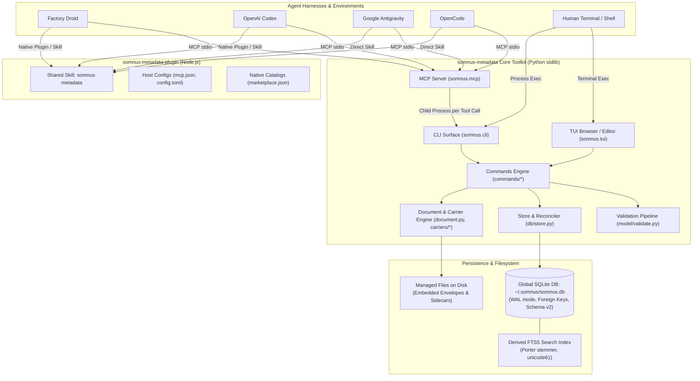

---

## 2. System Identity and Original Purpose

Somnus Metadata originated as the **Somnus YAML Frontmatter specification** (`somnus://metadata/core/2.0.0`), designed to overcome the fragmentation of file-level metadata across software repositories. 

Prior to Somnus, repositories relied on ad-hoc, host-specific conventions: Markdown frontmatter for static site generators (Jekyll, Hugo), docstrings in Python, JSDoc in TypeScript, rustdoc in Rust, or disparate external JSON ledgers. These conventions suffered from severe deficiencies:
- **Namespace Collisions:** Frontmatter keys (`title`, `tags`, `author`) collide across Hugo, Jekyll, Obsidian, and Zola with conflicting semantics.
- **Syntax Brittleness:** Comment envelopes in source code frequently broke linters, shebang lines, encoding cookies, or language syntax.
- **Fabricated Identity:** Agents and scripts frequently hand-edited or invented UUIDs, creation timestamps, and authority claims.
- **Opaque Payloads:** Metadata was unindexed, requiring slow recursive file tree traversals and regular expressions to locate assets.

### Normative Purpose and Invariants
Under `SPEC.md` and ratified decisions `DECISIONS.md` (D1–D19):
1. **Universal Sovereignty:** The Somnus semantic model is authoritative within the system. The payload structure under the `somnus:` namespace is invariant across every carrier format.
2. **Byte-Level Non-Destructive Invariant (`E_HOST`):** Writes to host files must preserve every single byte outside the metadata envelope. If placement would alter host semantics or modify code bytes, the write is refused with diagnostic code `E_HOST`.
3. **Closed Semantic Contract (Zero Unknown Fields, D5):** Every standardized object in the metadata model is closed. Invented keys, unapproved properties, and `null` values are rejected with `E_SCHEMA`. Experimental properties must live under `extensions.<owner>.data`.
4. **Three Discrete Clocks (D10):** The system strictly separates authorship time (`somnus.time`), applicability interval (`valid_time`), and observation instant (`observed_at`, `first_seen_at`, `last_seen_at`). Tools never fabricate midnight timestamps.
5. **Universal Artifact Scope:** The architecture is deliberately designed to encompass any file type, graduating from documentation into source code, configurations, data models, and binary payloads.

---

## 3. Architecture Evolution and Historical Decisions

The system’s trajectory reflects a deliberate transition from an exploratory schema proposal to an industrial, compiler-grade toolkit.

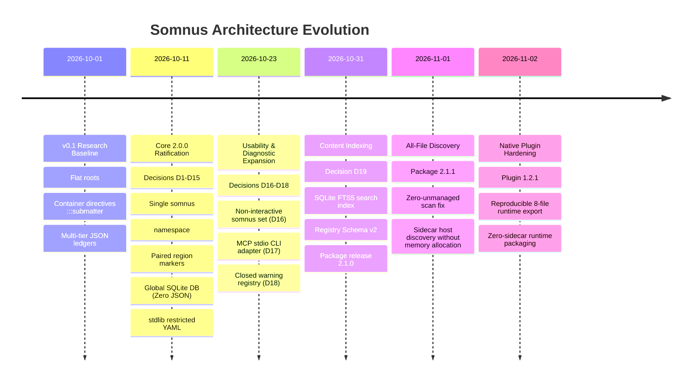

### Key Ratified Architecture Decisions (D1–D19)

| Decision | Title | Architectural Impact & Rationale | Current Status |
| :--- | :--- | :--- | :--- |
| **D1** | Single `somnus:` namespace | Replaced "Hybrid Semi-Flat" roots. Eliminates collisions with Jekyll/Hugo keys. Guarantees identical payload across all carriers. | **Implemented** (`SPEC.md` §4) |
| **D2** | Comment-marker regions with header registry | Reversed `:::submatter` container directives. Regions use paired comments (`<!-- somnus:region:begin -->`) carrying ID only; attributes live in header. | **Implemented** (`SPEC.md` §13, `regions.py`) |
| **D3** | URN-wrapped UUIDv7 identity | Mandates `urn:somnus:artifact:<uuidv7>`. Decouples UUID timestamp from document creation date. Legacy UUIDv4 wrapped losslessly. | **Implemented** (`SPEC.md` §3, `ids.py`) |
| **D4** | One global SQLite registry, zero JSON | Operator directive replacing two-tier JSON ledgers. High-performance SQLite database (`somnus.db`) with plain-English columns. JSON forbidden in storage/output. | **Implemented** (`SPEC.md` §18, `db/store.py`) |
| **D5** | Zero tolerance for unknown fields | Validator rejects unknown fields at any depth (`E_SCHEMA`). Open extension point restricted to `extensions.<owner>.data`. | **Implemented** (`model/validate.py`) |
| **D6** | Rich headers populated by tools | Commands (`new`, `stamp`, `fork`) populate headers via configuration cascade. Prohibits automated fabrication of dates or standing. | **Implemented** (`commands/_common.py`) |
| **D7** | Restricted YAML & canonical serializer | Stdlib-only restricted parser (`yamlsub.py`). Rejects anchors, aliases, tags, implicit types. Deterministic schema field ordering. | **Implemented** (`yamlsub.py`) |
| **D8** | Carrier matrix with host-preserving placement | Formalized carrier hierarchy (Markdown, Hash, Line, Slash, SQL, Block CSS/XML, Sidecar). Enforces byte-for-byte preservation. | **Implemented** (`carriers/*`, `document.py`) |
| **D9** | Scoped authority separate from role | Distinguishes `classification.role` from `authority.standing`. Acceptance requires explicit decision references and validity intervals. | **Implemented** (`model/validate.py`) |
| **D10** | Three separate clocks; no invented dates | Decouples authorship, applicability, and observation time. Missing dates remain missing. Disappearance is never deletion. | **Implemented** (`SPEC.md` §9, `db/store.py`) |
| **D11** | Qualified relations and typed claims | Replaced bare reference buckets with typed relations and claims. Cycle policies enforced for `supersedes`, `derived_from`, `part_of`. | **Implemented** (`model/validate.py`, `db/store.py`) |
| **D12** | Tool-enforced lifecycle state machine | Explicit state machine transitions (`draft` -> `review` -> `active` -> `superseded`, etc.). Transitions require reason and bump revision. | **Implemented** (`model/lifecycle.py`) |
| **D13** | Exact release resolution & versioned profiles | Strict rejection of unreleased schemas. Core 2.0.0 validator accepts only `somnus://metadata/core/2.0.0`. | **Implemented** (`model/validate.py`) |
| **D14** | Compiler-grade diagnostics | Standardized format: `path:line:col: severity CODE field: message`. Tab-separated mode `--tsv`. Stable exit codes (0, 1, 2). | **Implemented** (`output.py`) |
| **D15** | Dead-code isolation in `archive/` | Historical v0.1 specs, schemas, and v2 proposals moved to `archive/`. Indexing and imports strictly exclude `archive/`. | **Implemented** (`config.py`) |
| **D16** | Non-interactive header edits (`somnus set`) | Exposes 10 form fields for CLI/agent modification without terminal UI. Shared validation and single revision bump. | **Implemented** (`commands/set_fields.py`) |
| **D17** | MCP server as thin CLI adapter | Model Context Protocol stdio server reflection of CLI commands. Subprocess execution; tool output is text/TSV. | **Implemented** (`mcp.py`) |
| **D18** | Near-duplicate titles as advisory | Removed undefined `W_DUPLICATE_TITLE`. Colliding titles handled via `somnus new` refusal and `somnus stale` reports. | **Implemented** (`commands/new.py`, `commands/stale.py`) |
| **D19** | Full-text search as derived registry index | Derived SQLite FTS5 table (`search.sql`). Indexes path, title, summary, tags, and body (up to 1M chars). BM25 query via `somnus q --text`. | **Implemented** (`db/store.py`, `commands/query.py`) |

---

## 4. Repository and Product Boundaries

The division between the two repositories represents an intentional architectural boundary:

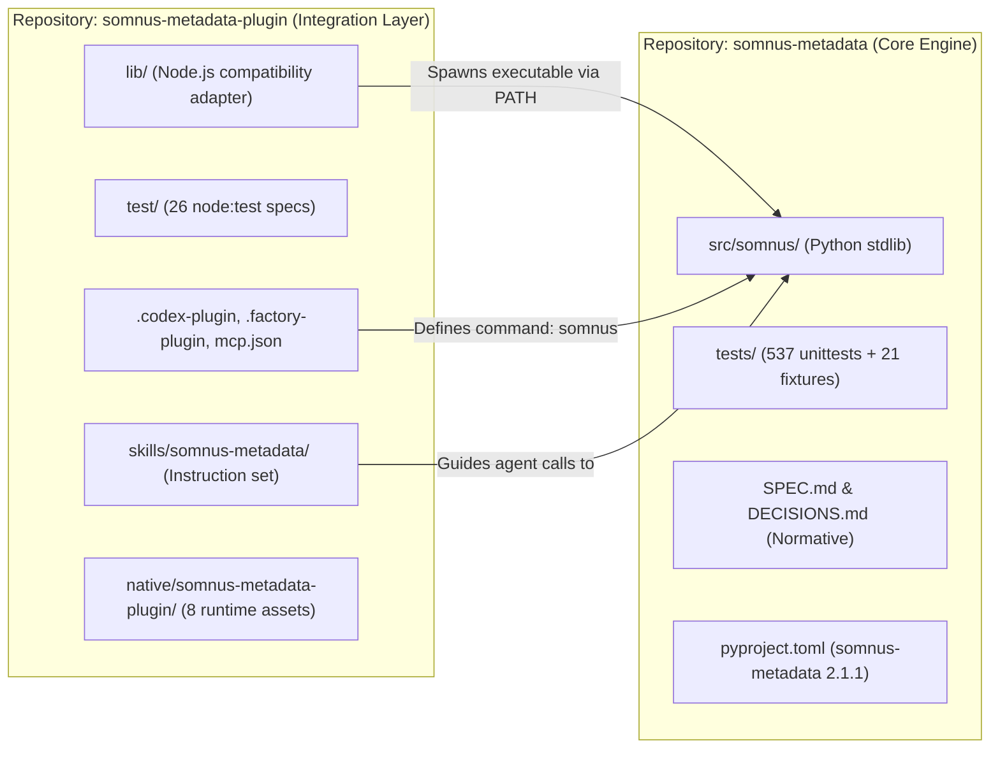

### Boundary Rules and Ownership
1. **Core Sovereignty:** `somnus-metadata` owns the standard specification, schema definitions, YAML subset parsing, document envelope extraction, host-byte preservation, validation, SQLite persistence, search indexing, CLI, TUI, and MCP JSON-RPC protocol implementation. It contains zero knowledge of specific agent harnesses.
2. **Integration Adaptation:** `somnus-metadata-plugin` owns agent-facing discovery, installation into harness directories (`~/.factory`, `~/.codex`, `~/.gemini`, `~/.config/opencode`), host configuration file editing (`config.toml`, `mcp.json`), skill distribution, and export verification.
3. **No Code Duplication:** The plugin contains zero metadata parsing, validation, or database logic. It does not import or execute backend Python code directly; it interacts solely by spawning the installed `somnus` CLI or MCP adapter.
4. **Independent Release Lifecycle:** The core is published to PyPI (`somnus-metadata 2.1.1`). The plugin is a private repository distributed via native plugin catalogs or direct script installation (`somnus-metadata-plugin 1.2.1`).

---

## 5. Current Runtime Topology

In the active operational environment (Linux/POSIX, Python 3.11–3.14, Node >= 18.17):

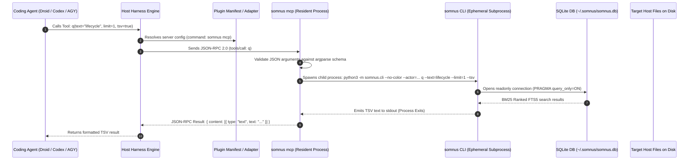

### Topology Characteristics
- **Process Model:** `somnus mcp` runs as a long-lived stdio JSON-RPC server managed by the agent harness. However, every tool call executed by the MCP server spawns a **new ephemeral child process** (`python3 -m somnus.cli ...`).
- **State Isolation:** The MCP server holds zero application state between calls. Relative paths resolve against the MCP server process's current working directory.
- **Concurrency & Locking:** SQLite is operated in Write-Ahead Logging (`WAL`) mode with `PRAGMA foreign_keys = ON`. Read queries (`somnus q`) execute with `mode=ro` and `PRAGMA query_only = ON`. Writes acquire SQLite transaction locks with a 10-second timeout.
- **Process-Wide Event Attribution:** Every mutating command accepts `--actor <NAME>`. The MCP server injects the harness identity (e.g., `--actor somnus-metadata-plugin` or `--actor codex`), attributing every mutation in the append-only `events` ledger.

---

## 6. Complete Core Module Map

The core Python package (`src/somnus/`) contains 8,138 lines of stdlib Python and 207 lines of SQL, organized into distinct architectural subsystems.

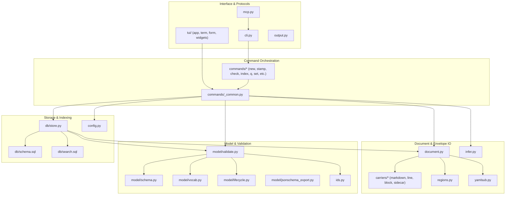

### Detailed Subsystem Inventory

| Subsystem / Module | Responsibility | Key Classes / Functions | Persistence & I/O | Error & Diagnostic Behavior | Test Coverage |
| :--- | :--- | :--- | :--- | :--- | :--- |
| **`yamlsub.py`** | Stdlib-only restricted YAML subset parser and canonical serializer (D7). | `parse()`, `dumps()`, `YAMLError` | In-memory text processing | Raises `YAMLError` with 1-based line/col. | `tests/test_yamlsub.py` |
| **`ids.py`** | URN wrapping, UUIDv7 parsing/minting, slugification (D3). | `mint_artifact_urn()`, `is_artifact_urn()`, `slugify()` | In-memory string operations | Returns boolean; raises `ValueError` on bad URNs. | `tests/test_ids.py` |
| **`carriers/`** | Carrier matrix: locates, extracts, and renders envelopes across file types (D8). | `MarkdownCarrier`, `HashCarrier`, `LineCarrier`, `BlockCarrier`, `SidecarCarrier` | Scans and splices lines of text | Raises `CarrierError` (`E_HOST`, `E_ENVELOPE`). | `tests/test_carriers.py` |
| **`document.py`** | Document abstraction; coordinates carriers, byte preservation, atomic saves. | `Document`, `load()`, `atomic_write()`, `_verify_preserved()` | Atomic write via temp file & `os.replace` | Compares pre/post host bytes; raises `E_HOST` if modified. | `tests/test_document.py` |
| **`regions.py`** | Lexical scanning, stack pairing, and registry synchronization for in-body markers (D2). | `scan_markers()`, `markdown_code_mask()`, `MarkerScan` | Scans text lines; masks code blocks | Emits `E_REGION` on unclosed, crossed, or duplicate markers. | `tests/test_regions.py` |
| **`infer.py`** | Heuristic title, type, and classification inference for unmanaged files. | `infer()`, `infer_title()`, `infer_type()` | AST parsing for Python docstrings | Falls back gracefully to filename stems; never crashes. | `tests/test_commands.py` |
| **`model/validate.py`** | 4-level validation pipeline: carrier, core, semantic, canon (D5, D14). | `validate()`, `Resolver`, `validate_payload()` | Reads document structures and queries registry | Emits compiler-grade `Diagnostic` objects (`E_*`, `W_*`). | `tests/test_validate.py` |
| **`model/lifecycle.py`** | Tool-enforced lifecycle state machine and transition rules (D12). | `validate_transition()`, `bump_revision()` | In-memory dict transformations | Rejects illegal status jumps (`E_LIFECYCLE`). | `tests/test_lifecycle.py` |
| **`db/store.py`** | Global SQLite registry connection, scanning, reconciliation, FTS5 search (D4, D19). | `Store`, `scan()`, `observe()`, `searchable_body()`, `fts_query()` | Direct SQLite connection (`~/.somnus/somnus.db`) | Logs events; opens/resolves conflicts (`E_REVISION`, `E_AUTHORITY`). | `tests/test_store.py` |
| **`commands/`** | 18 CLI subcommands executing user actions (`new`, `stamp`, `check`, `index`, `q`, etc.). | `run()` functions in each command module | Orchestrates document and store operations | Returns integer exit codes (0, 1, 2) and prints text/TSV. | `tests/test_commands.py` |
| **`tui/`** | ANSI terminal browser and header editor (D16). | `Terminal`, `ListView`, `FormModel`, `BrowserScreen`, `EditorScreen` | Direct raw terminal I/O (POSIX termios / Win32 console) | Catches terminal errors; drains note sinks to status bar. | `tests/test_tui.py`, `tests/test_term_windows.py` |
| **`mcp.py`** | JSON-RPC 2.0 Model Context Protocol stdio server (D17). | `Server`, `run_cli()`, `build_tools()`, `command_line()` | Stdio streams (stdin/stdout) | Wraps child process exits in MCP content; protocol errors in JSON-RPC. | `tests/test_mcp.py` |

---

## 7. Universal Artifact and Semantic Data Model

The Somnus semantic data model represents an artifact as an authored, verifiable knowledge record.

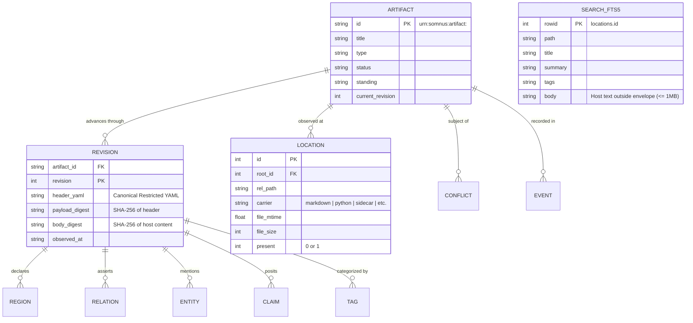

### Core Schema Payload Anatomy (`somnus://metadata/core/2.0.0`)
A conformant header payload contains strictly closed top-level fields:
```yaml
somnus:
  schema: "somnus://metadata/core/2.0.0"
  id: "urn:somnus:artifact:01a19a67-7882-770a-9fc8-811ac57f407d"
  revision: 1
  title: "Example Artifact Title"
  summary: "Concise summary of artifact purpose."
  classification:
    category: "engineering"   # engineering | research | operations | governance | context
    type: "source-code"        # 20 controlled types (specification, report, plan, etc.)
    role: "informative"        # normative | informative | historical | working
    scope: "component"         # ecosystem | system | subsystem | component | module | line
    tags: ["storage", "sqlite"]
  lifecycle:
    status: "draft"            # draft | review | active | provisional | superseded | deprecated | retired | abandoned
  authority:
    standing: "candidate"      # unasserted | candidate | accepted | retired | rejected
    scopes:
      - target_ref: "urn:somnus:artifact:01a19a67-7882-770a-9fc8-811ac57f407d"
        aspects: ["content"]
  time:
    created_at: "2026-11-02T05:00:00Z"
    updated_at: "2026-11-02T05:00:00Z"
  access:
    visibility: "internal"     # public | internal | confidential | restricted
    allowed_uses: ["archive", "search", "reason"]
  ingestion:
    disposition: "candidate"
    body_role: "source"        # narrative | specification | instruction | source | data | ...
  bindings:                    # MANDATORY for sidecars; FORBIDDEN for embedded envelopes
    - target: "example.py"
      role: "primary"
      required: true
```

---

## 8. Carrier Selection and Host Adaptation

The carrier system (`src/somnus/carriers/`) decouples envelope storage and formatting from the semantic model.

### File-Format Compatibility Matrix

| File Extensions / Formats | Carrier Selected | Carrier Class (`src/somnus/carriers/`) | Envelope Placement & Syntax | Modifies Source Host? | Generates Sidecar File? | Registry-Only Metadata? | Content Searchable in FTS5? | Test Evidence |
| :--- | :--- | :--- | :--- | :---: | :---: | :---: | :---: | :--- |
| `.md`, `.markdown`, `.mdx` | `markdown` | `MarkdownCarrier` | Leading `---` ... `---` frontmatter (or `<!-- somnus:metadata:v2 ... somnus:end -->`) | **Yes** (in-place) | No | No | **Yes** (outside envelope) | `test_carriers.py`, Fixtures 1, 3 |
| `.py`, `.pyw` | `python` | `HashCarrier` | `# somnus:metadata:v2` ... `# somnus:end` after shebang and `coding:` cookie | **Yes** (in-place) | No | No | **Yes** (outside envelope) | `test_carriers.py`, Fixture 2 |
| `.sh`, `.bash`, `.zsh` | `shell` | `HashCarrier` | `# somnus:metadata:v2` ... `# somnus:end` after shebang `#!` | **Yes** (in-place) | No | No | **Yes** (outside envelope) | `test_carriers.py` |
| `.ps1`, `.psm1`, `.psd1` | `powershell` | `HashCarrier` | `# somnus:metadata:v2` ... `# somnus:end` after `#Requires` and shebang | **Yes** (in-place) | No | No | **Yes** (outside envelope) | `test_carriers.py` |
| `.r`, `.R` | `r` | `HashCarrier` | `# somnus:metadata:v2` ... `# somnus:end` after shebang | **Yes** (in-place) | No | No | **Yes** (outside envelope) | `test_carriers.py` |
| `.toml` | `toml` | `HashCarrier` | `# somnus:metadata:v2` ... `# somnus:end` in leading comment block | **Yes** (in-place) | No | No | **Yes** (outside envelope) | `test_carriers.py` |
| `.yaml`, `.yml` *(except `*.somnus.yaml`)* | `yaml` | `HashCarrier` | `# somnus:metadata:v2` ... `# somnus:end` in leading comments | **Yes** (in-place) | No | No | **Yes** (outside envelope) | `test_carriers.py` |
| `.tex`, `.sty`, `.cls`, `.ltx` | `tex` | `LineCarrier` | `% somnus:metadata:v2` ... `% somnus:end` after `% !TeX` magic comments | **Yes** (in-place) | No | No | **Yes** (outside envelope) | `test_carriers.py` |
| `.js`, `.mjs`, `.cjs`, `.jsx`, `.ts`, `.tsx` | `js` | `LineCarrier` | `// somnus:metadata:v2` ... `// somnus:end` after shebang `#!` | **Yes** (in-place) | No | No | **Yes** (outside envelope) | `test_carriers.py` |
| `.rs`, `.c`, `.h`, `.cc`, `.cpp`, `.hpp`, `.go`, `.java`, `.kt`, `.swift`, `.cs` | `slash` | `LineCarrier` | `// somnus:metadata:v2` ... `// somnus:end` in leading comment block | **Yes** (in-place) | No | No | **Yes** (outside envelope) | `test_carriers.py` |
| `.sql` | `sql` | `LineCarrier` | `-- somnus:metadata:v2` ... `-- somnus:end` in leading comment block | **Yes** (in-place) | No | No | **Yes** (outside envelope) | `test_carriers.py` |
| `.css`, `.scss`, `.less` | `css` | `BlockCarrier` | `/* somnus:metadata:v2 ... somnus:end */` after `@charset` line | **Yes** (in-place) | No | No | **Yes** (outside envelope) | `test_carriers.py` |
| `.html`, `.htm`, `.xhtml`, `.xml`, `.svg` | `xml` | `BlockCarrier` | `<!-- somnus:metadata:v2 ... somnus:end -->` after `<?xml...?>` and `<!DOCTYPE...>` | **Yes** (in-place) | No | No | **Yes** (outside envelope) | `test_carriers.py` |
| `.json`, `.csv`, `.tsv`, `.parquet`, `.png`, `.jpg`, `.pdf`, `.zip`, extensionless files (`.gitignore`, `CODEOWNERS`, `Dockerfile`) | `sidecar` | `SidecarCarrier` | Detached file `<file>.somnus.yaml` containing pure YAML payload + `bindings` array | **No** (host untouched) | **Yes** (`<file>.somnus.yaml`) | No | **Yes** if UTF-8; **No** if binary | `test_carriers.py`, `test_store.py` |

---

## 9. Metadata and Document Lifecycle

Document mutations follow strict atomic protocols to guarantee zero file corruption:

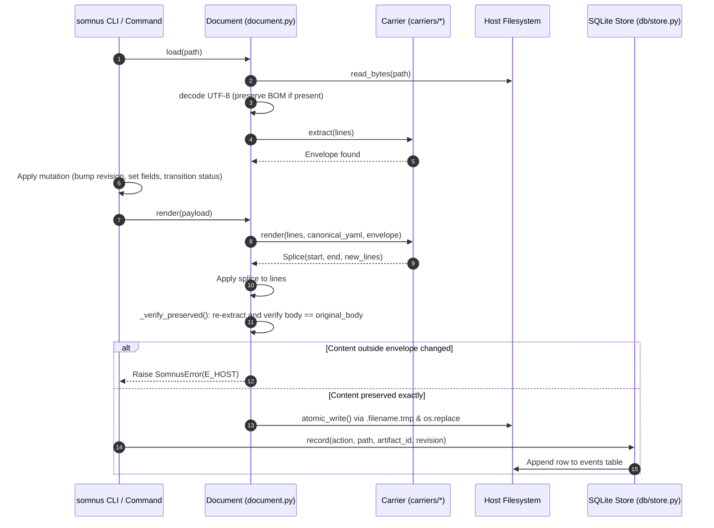

### Lifecycle Operations
1. **Creation (`somnus new`)**: Mints a UUIDv7, scaffolds `# Title`, writes revision 1 with status `draft`. Refuses creation if title similarity >= 0.9 with an existing document (unless `--force`).
2. **Adoption (`somnus stamp`)**: Analyzes an unmanaged file via `infer.py`. In dry-run mode (default), outputs a unified diff. With `--write`, applies atomic write (in-place comments for embeddable code/Markdown; detached `<file>.somnus.yaml` for unsupported formats).
3. **Field Editing (`somnus set`)**: Edits any of the 10 form fields (`title`, `summary`, `classification.*`, `visibility`, `disposition`), validates the result, increments `revision` by 1, and saves atomically.
4. **Lifecycle Transitions (`somnus status`)**: Advances `lifecycle.status` through the valid state graph (`draft` -> `review` -> `active`, etc.). Status changes to `superseded` require `--replacement`; transitions to `abandoned` require `--reason`.
5. **Reconciliation & Bumping (`somnus bump`)**: Updates the payload revision and resolves `revision` conflicts when the underlying host body has been modified.
6. **Forking (`somnus fork`)**: Creates a new artifact identity (`urn:somnus:artifact:<new-uuidv7>`) at revision 1 with a `derived_from` relation pointing to the parent.

---

## 10. SQLite Registry and Persistence Architecture

The Somnus global registry (`~/.somnus/somnus.db`) is the central persistence substrate.

### Database Design & Schema v2 DDL Analysis
The DDL is declared across `src/somnus/db/schema.sql` (core relational tables) and `src/somnus/db/search.sql` (FTS5 search index):
- **Roots (`roots`)**: Registered filesystem roots (`id`, `path`, `added_at`, `last_scan_at`).
- **Artifacts (`artifacts`)**: Highest observed state (`id`, `title`, `type`, `category`, `role`, `scope`, `status`, `standing`, `visibility`, `current_revision`, `first_seen_at`, `last_seen_at`).
- **Revisions (`revisions`)**: Immutable observed states (`artifact_id`, `revision`, `title`, `status`, `standing`, `header_yaml`, `payload_digest`, `body_digest`, `observed_at`).
- **Locations (`locations`)**: Physical file bindings (`id`, `root_id`, `rel_path`, `artifact_id`, `revision`, `carrier`, `file_mtime`, `file_size`, `payload_digest`, `body_digest`, `present`, `first_seen_at`, `last_seen_at`).
- **Knowledge Projections**: `tags`, `regions`, `relations`, `entities`, `claims` materialized per revision.
- **Conflicts (`conflicts`)**: Active and resolved conflicts (`kind` in `'revision'`, `'duplicate-id'`, `'authority'`, `'identity'`).
- **Event Ledger (`events`)**: Append-only log (`at`, `actor`, `action`, `artifact_id`, `revision`, `path`, `detail`). Modification or deletion is prevented at the SQLite engine level by triggers:
  ```sql
  CREATE TRIGGER events_no_update BEFORE UPDATE ON events
  BEGIN SELECT RAISE(ABORT, 'events are append-only'); END;

  CREATE TRIGGER events_no_delete BEFORE DELETE ON events
  BEGIN SELECT RAISE(ABORT, 'events are append-only'); END;
  ```

### Authoritative vs. Derived Persistence
| Database Element | Authority Status | Behavior upon Complete Registry Deletion (`rm somnus.db`) |
| :--- | :--- | :--- |
| `revisions.header_yaml` | Derived / Replicated | Fully recovered by `somnus index` from on-disk envelopes. |
| `locations` | Derived Observation | Fully recovered by `somnus index` by re-walking roots. |
| `search` (FTS5) | Pure Derived Index | Fully reconstructed by `somnus index --full`. |
| `knowledge.*` tables | Derived Projection | Fully re-materialized from recovered headers. |
| `events` Ledger | **Sole Authoritative Truth** | **Irretrievably lost.** Documents do not carry history arrays (D4). Past actions cannot be recovered from disk. |
| `conflicts` History | **Sole Authoritative Truth** | Past resolved conflicts and timestamps are lost; active conflicts re-open. |

---

## 11. Content Indexing and Search Architecture

Ratified Decision D19 established full-text search as an SQLite FTS5 derived table.

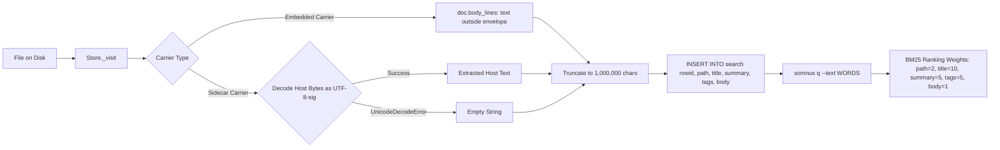

### Search Mechanism Specifications
- **Virtual Table DDL (`search.sql`):**
  ```sql
  CREATE VIRTUAL TABLE IF NOT EXISTS search USING fts5(
      path, title, summary, tags, body,
      tokenize = 'porter unicode61 remove_diacritics 2'
  );
  ```
- **Indexed Body Content (`searchable_body`, `store.py:81–90`):**
  - Embedded hosts: All lines outside the metadata envelope, joined by newlines.
  - Sidecars: The host file decoded as `utf-8-sig`. If decoding fails (binary files: PDF, images, compiled binaries), `searchable_body` returns `""`.
  - Cap: Hard limit of **1,000,000 characters** per location to prevent SQLite blob bloat.
- **Query Processing (`fts_query`, `store.py:93–100`):**
  - Terms are whitespace-delimited. Every term is required (`AND` boolean logic).
  - Trailing asterisks (`word*`) trigger FTS5 prefix queries.
  - Results are ranked via BM25 with column weights: `path: 2.0`, `title: 10.0`, `summary: 5.0`, `tags: 5.0`, `body: 1.0`.
  - Output formats: Aligned text with bracketed keyword excerpts (`[...]`) or tab-separated TSV (`--tsv`).

---

## 12. Freshness, Synchronization, and Change Detection

A critical systems finding of this audit is the mechanism of change detection.

### Change Detection Matrix

| Mechanism | Status | Implementation Truth in Core Architecture |
| :--- | :---: | :--- |
| **Filesystem Watchers** (`inotify`, `kqueue`, `ReadDirectoryChangesW`) | **ABSENT** | Zero watcher implementations exist. Neither core nor plugin imports or uses filesystem event APIs. |
| **Native OS Change Notifications** | **ABSENT** | The system receives no OS-level filesystem signals. |
| **Periodic Background Scans / Cron** | **ABSENT** | No daemon, background worker, systemd service, or timer exists. |
| **Lazy Refresh during Queries** | **ABSENT** | `somnus q` runs `PRAGMA query_only = ON`. It performs zero disk checks, stat calls, or reconciliation during query execution. |
| **Incremental Reconciliation** | **IMPLEMENTED** | `somnus index` walks registered roots comparing `(file_mtime, file_size)` against the `locations` table. Unchanged files skip parsing. |
| **Explicit Manual Indexing** | **IMPLEMENTED** | `somnus index [ROOT...] [--full]` executes a complete synchronous reconciliation pass. |
| **Agent-Triggered Tool Updates** | **PARTIAL** | Core mutating commands (`stamp`, `bump`, `set`, `status`, `fork`) call `Store.observe(path)`, immediately updating the registry for that specific file. |
| **Plugin Change Hooks** | **ABSENT** | The plugin declares no file save or pre-commit hooks. |

### Architectural Consequence of the Freshness Gap
If an external tool, IDE, git pull, or agent edits a managed file outside the `somnus` CLI:
1. The SQLite registry becomes **silently stale**. Queries continue returning outdated metadata and FTS5 excerpts.
2. When `somnus index` is subsequently executed, the scanner detects that `(mtime, size)` has changed. Because the body digest differs from the stored revision digest, Somnus flags a **`revision` conflict** (`E_REVISION`), requiring an explicit `somnus bump` to reconcile.

---

## 13. CLI Architecture

The CLI (`src/somnus/cli.py`, `src/somnus/commands/`) is the primary execution interface.

### Command Dispatch Architecture
- Built on standard `argparse` with lazy submodule importing: each subcommand (`new`, `stamp`, `check`, etc.) is imported dynamically upon invocation via `importlib.import_module(f"somnus.commands.{name}")`.
- Command implementations reside in `src/somnus/commands/`, inheriting shared context and error formatting from `_common.py`.
- **Exit Code Contract (`output.py`):**
  - `0`: Success (clean execution, valid syntax, zero errors).
  - `1`: Validation errors, refused operations, schema violations, or open conflicts.
  - `2`: Usage errors, syntax errors, missing files, or environment/IO failures.

---

## 14. TUI Architecture

The Terminal User Interface (`src/somnus/tui/`) provides full-screen interactive navigation and metadata editing without third-party curses or textual libraries.

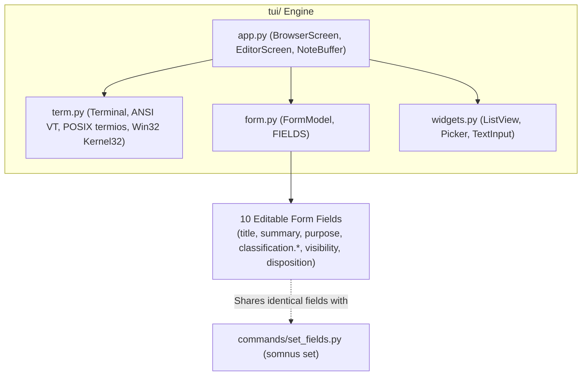

### Key TUI Architectural Characteristics
- **Portability:** Uses raw VT100/ANSI sequences over stdio. On POSIX, manipulates `termios` and `fcntl`. On Windows, utilizes `ctypes` wrappers around `kernel32.dll` and `msvcrt.dll` to enable virtual terminal processing.
- **Non-Interactive Symmetry (D16):** The TUI form and the non-interactive CLI command `somnus set` consume the **exact same field specifications** (`FIELDS` in `form.py`). The TUI cannot drift from the CLI in field capabilities.
- **Informational Note Sink:** To prevent diagnostic logs from corrupting alternate-screen rendering, `app.py` installs `NoteBuffer` via `capture_notes()`. Background notes from `Ctx.record()` are collected and drained cleanly into the TUI status bar.

---

## 15. MCP Architecture

The Model Context Protocol adapter (`src/somnus/mcp.py`) bridges Somnus into agent harnesses via stdio JSON-RPC 2.0.

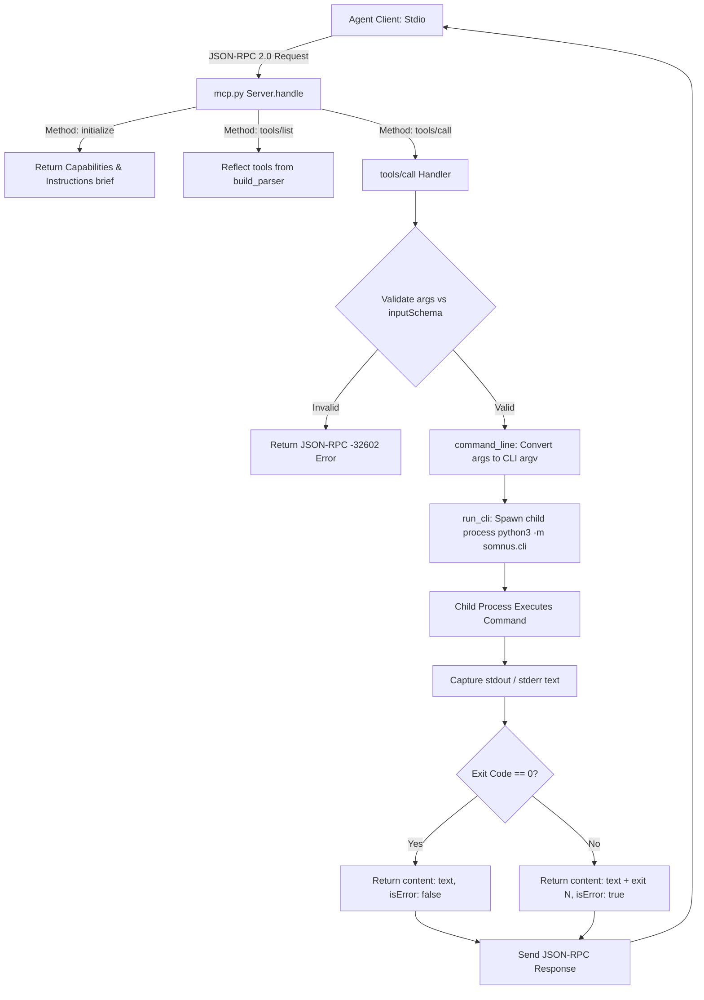

### Architectural Assessment of MCP Adapter
1. **Zero Schema Drift:** Tools are generated programmatically from the CLI’s `argparse` definitions via `build_tools()`. Adding a CLI argument immediately updates the MCP tool schema.
2. **Subprocess Isolation vs. Latency Tradeoff:** Spawning `python3 -m somnus.cli` for every call ensures memory isolation and guarantees that an unhandled crash cannot terminate the MCP stdio session. However, it incurs interpreter startup latency (100–300ms per invocation).
3. **Strict Text Transport:** Conforming to D4, tool results return formatted text or TSV. JSON framing exists only for protocol compliance.

---

## 16. Agent Plugin Architecture and Harness Adapters

The integration package (`somnus-metadata-plugin`) provides multi-harness agent adaptation.

### Harness Integration Matrix

| Agent Harness | Discovery / Manifest File | Configuration Location | Config Syntax | MCP Connection Mechanism | Skill Installation Path |
| :--- | :--- | :--- | :--- | :--- | :--- |
| **Factory Droid** | `.factory-plugin/plugin.json`, `.factory-plugin/marketplace.json` | `~/.factory/mcp.json` | JSON | Stdio command `somnus --actor droid mcp` | `~/.factory/skills/somnus-metadata/` |
| **OpenAI Codex** | `.codex-plugin/plugin.json`, `.agents/plugins/marketplace.json` | `~/.codex/config.toml` | TOML (Managed block `# >>> ... # <<<`) | Stdio command `somnus --actor codex mcp` | `~/.codex/skills/custom/somnus-metadata/` |
| **Google Antigravity** | `plugin.json` (root) | `~/.gemini/config/plugins/somnus-metadata/mcp_config.json` | JSON | Stdio command `somnus --actor antigravity mcp` | `~/.gemini/skills/somnus-metadata/` |
| **OpenCode** | `plugin.json` (root) | `~/.config/opencode/opencode.json(c)` | JSON / JSONC | Local MCP command `["somnus", "--actor", "opencode", "mcp"]` | `~/.config/opencode/skills/somnus-metadata/` |

### Plugin Packaging Verification (`scripts/build-native.mjs`)
The plugin enforces an 8-file clean export for native packaging under `native/somnus-metadata-plugin/`:
- `plugin.json`
- `mcp.json`
- `.codex-plugin/plugin.json`
- `.factory-plugin/plugin.json`
- `skills/somnus-metadata/SKILL.md`
- `skills/somnus-metadata/references/setup.md`
- `skills/somnus-metadata/references/mcp-tools.md`
- `skills/somnus-metadata/references/recipes.md`

All developer files (`package.json`, `.gitignore`, `lib/`, `test/`, and any `*.somnus.yaml` sidecars) are strictly excluded from the distributed runtime payload.

---

## 17. Installation, Packaging, and Deployment

### Packaging Specifications
- **Core Package (`somnus-metadata` 2.1.1):** Configured via `pyproject.toml` using `setuptools>=68.0.0`.
  - Python requirement: `>=3.11`.
  - Dependencies: **Empty (`dependencies = []`)**. Zero third-party runtime dependencies.
  - Console Scripts: `somnus = "somnus.cli:main"`, `somnus-metadata = "somnus.cli:main"`.
  - PEP 668 Compliance: Compatible with managed Linux environments; standard deployment utilizes `pip install somnus-metadata` within a dedicated virtual environment (e.g. `~/.venvs/global/bin/pip`) exposed to `PATH`.
- **Plugin Distribution:** Installed via `somnus-plugin install` (direct adapter mode) or through native harness plugin managers (`codex plugin marketplace add`, `droid plugin install`).

---

## 18. Security, Isolation, and Data Integrity

1. **Path Traversal & Injection Defense:**
   - In `mcp.py`, argument tokenization strips NUL characters (`\x00`).
   - In `mcp.py::command_line()`, arguments use `--flag=value` and positionals follow `--`, preventing argument injection.
   - On Windows, `spawnForm()` safely quotes arguments with whitespace when invoking wrappers through `cmd.exe`.
2. **Byte-Level Preservation Guard (`_verify_preserved` in `document.py:188–202`):**
   - Before any file is modified, the new text is re-parsed. The host content outside the envelope is extracted and compared byte-for-byte against the original body lines. Any discrepancy halts execution with `E_HOST`.
3. **Atomic Replacement (`atomic_write` in `document.py:239–258`):**
   - Writes write first to a temporary file (`.filename.tmp`) in the same directory, flush buffers, call `os.fsync()`, replicate original permissions via `os.chmod()`, and replace the destination via `os.replace()`, preventing partial-write corruption.
4. **Append-Only Event Ledger:**
   - Database triggers prevent `UPDATE` or `DELETE` on the `events` table, creating an immutable audit trail of who modified metadata, at what timestamp, and with what parameters.

---

## 19. Test Coverage and Verified Capabilities

The system maintains a comprehensive, multi-layered verification harness:

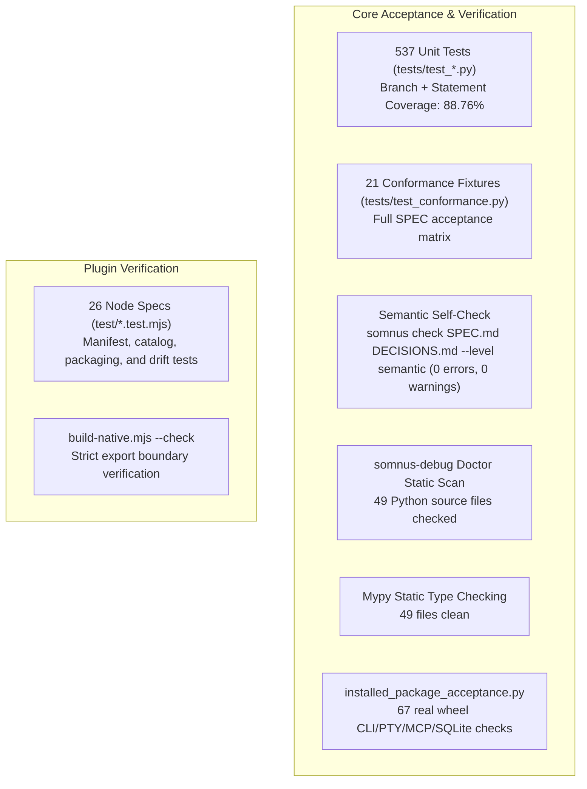

### Verified Runtime Evidence
- **Source Suite:** 537/537 tests pass in 3.98s.
- **Specification Semantic Conformance:** 0 errors, 0 warnings.
- **Plugin Test Suite:** 26/26 tests pass in 1.33s.
- **Package Acceptance:** Verified on live wheel installations with real PTY terminals and stdio MCP pipes.

---

## 20. Architectural Inconsistencies and Technical Debt

1. **Subprocess Spawning Latency in MCP:**
   - `mcp.py` spawns a Python subprocess for every tool call. While architecturally robust against crashes, it adds 100–300ms overhead per call, degrading agent tool-chain responsiveness.
2. **Monotonic Database Growth & Deletion Leakage:**
   - When files are deleted, `locations.present` is set to `0`. However, old revisions, entities, claims, and relations remain in SQLite indefinitely. No compaction, garbage collection, or purge command exists.
3. **Binary File Indexing Exclusion:**
   - If a sidecar host cannot be decoded as UTF-8, its search body is set to `""`. Binary assets (PDFs, images, checkpoints) cannot be searched by content, only by authored title and tags.
4. **Unmanaged Scanner Exclusion Discrepancy:**
   - In `Store.scan`, unmanaged hosts without sidecars are discovered by checking `carriers.for_path(path) is None`. However, if an unmanaged file has an extension matching an embedded carrier (e.g., an unmanaged `.py` or `.md`), it is read into memory to check for envelopes, creating unequal memory consumption between supported and unsupported unmanaged files.
5. **Near-Duplicate Similarity Metric Inconsistency:**
   - `somnus new` refuses creation at title similarity >= 0.90, while `somnus stale` reports near-duplicates at similarity >= 0.85. The thresholds are hardcoded and non-configurable.

---

## 21. Sidecar Root-Cause Investigation

A primary mandate of this audit is to resolve why `.somnus.yaml` sidecar files are appearing across codebases, including for Python and Markdown files that have native carrier support.

### The Observed Filesystem Evidence
The filesystem exhibits sidecar companion files across multiple directories:
- Configuration sidecars: `.coveragerc.somnus.yaml`, `.gitignore.somnus.yaml`, `package.json.somnus.yaml`.
- Code & Markdown sidecars: `muaddib.py.somnus.yaml`, `transformer_backbone.py.somnus.yaml`, `README.md.somnus.yaml`, `available-models.md.somnus.yaml`.

### Forensic Trace of Sidecar Creation

Our investigation traced the exact genesis of both classes of sidecars:

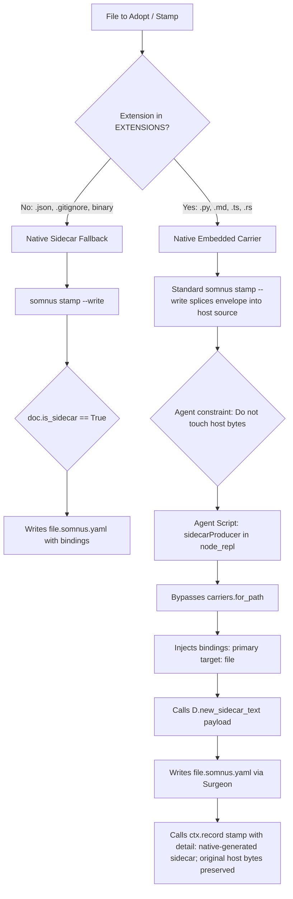

### Forensic Proof from Git & Execution Logs
1. **Class 1: Legitimate Fallback Sidecars (Core Behavior)**
   - Files like `.gitignore`, `package.json`, `.coveragerc`, and `.devcontainer.json` do not have comment syntax supported by Somnus.
   - In `src/somnus/carriers/__init__.py:188–194`, `carrier_name_for(path)` returns `None`.
   - In `document.py:313–314`, `load()` sets `doc.is_sidecar = True`.
   - In `commands/stamp.py:50–59`, when `doc.is_sidecar` is true, the command automatically creates `<file>.somnus.yaml`. This is **expected, specified fallback behavior**.
2. **Class 2: Artificial Sidecars on Supported Source Files (Agent Automation Artifact)**
   - In `/home/daeron/Repositories/Omphalos`, files like `muaddib.py.somnus.yaml`, `transformer_backbone.py.somnus.yaml`, and `README.md.somnus.yaml` were created on **2026-11-02 at 05:48:05 UTC**.
   - Inspection of `/home/daeron/.somnus/somnus.db` revealed events 2286–2377 with detail:
     `"native-generated sidecar; original host bytes preserved"`, authored by actor `codex`.
   - Examination of the session transcript (`~/.codex/sessions/2026/11/01/rollout-2026-11-01T21-47-08-01a19a5e-3800-7ca2-8969-8a8124409e76.jsonl`, lines 1144, 1520, 1522) revealed the exact smoking gun:
     An autonomous agent (`codex`) was commissioned with achieving "zero unmanaged files" across five roots without modifying host source files. Because `somnus stamp --write` would alter `.py` and `.md` source files by inserting comments, the agent executed a custom Node.js script that bypassed `carriers.for_path()`, generated `D.new_sidecar_text()` payloads, created `.somnus.yaml` companions via Surgeon, and recorded them in SQLite.
   - **Conclusion:** Sidecars on `.py` and `.md` files were **not** generated by a core regression or automatic core default; they were generated by an **external agent automation script** that exploited the core's sidecar-loading compatibility path (`document.py:322–327`) to avoid modifying repository files.

---

## 22. Proposed Registry-Backed Virtual Carrier Architecture

The operator desires to evaluate eliminating filesystem sidecars entirely in favor of **Registry-Backed Virtual Carriers**.

### Architectural Evaluation of the Virtual Carrier Model

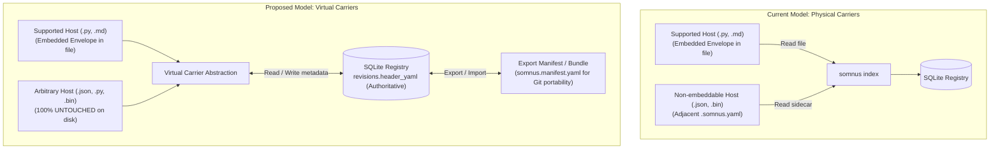

### Technical Feasibility Analysis
1. **Schema Readiness: 100% Ready.**
   - In `src/somnus/db/schema.sql`, the `revisions` table already stores the full canonical YAML header in `header_yaml TEXT NOT NULL`.
   - The `locations` table stores `carrier TEXT NOT NULL`. It can store `carrier = 'virtual'` with zero DDL changes.
2. **Document Layer Refactoring:**
   - In `document.py`, `Document` must be updated to decouple `meta_path` from physical disk existence.
   - If `path` has no embedded envelope and no `.somnus.yaml` exists, `load()` queries the registry. If a virtual carrier record exists, it populates `doc.data` directly from `revisions.header_yaml`.
3. **Indexing & Stamping Decoupling:**
   - `somnus stamp PATH --virtual` records the inferred metadata directly into the registry without writing any file to disk.
   - `somnus index` treats files with active virtual carrier records as managed, checking their `(mtime, size)` against `locations` and re-verifying their `body_digest`.

### Tradeoff Comparison

| Architectural Dimension | Existing Architecture (Physical Carriers + Sidecars) | Proposed Architecture (Embedded + Registry Virtual Carriers) |
| :--- | :--- | :--- |
| **Filesystem Cleanliness** | **Poor:** Repository polluted with companion `.somnus.yaml` files. | **Clean:** Zero companion files created on disk. |
| **Source Byte Preservation** | High for sidecars; Modifies embeddable code/Markdown files. | **100% Guaranteed:** Source files remain completely untouched. |
| **Decoupled Disaster Recovery** | **High:** If `somnus.db` is destroyed, `somnus index` completely reconstructs the registry from disk files. | **Vulnerable without Manifests:** If `somnus.db` is lost, virtual metadata is lost unless exported to a repository manifest. |
| **Git & Version Control** | Sidecars are tracked as separate git files, cluttering diffs and commits. | Requires a single git-tracked bundle/manifest (e.g. `somnus.lock.yaml`) per repository. |
| **Tooling & Build System Friction** | Build tools, linters, and packagers must explicitly ignore `.somnus.yaml`. | **Zero friction:** Build tools never see metadata artifacts. |

---

## 23. Compatibility and Migration Considerations

1. **Backwards Compatibility:**
   - Core schema `somnus://metadata/core/2.0.0` remains unchanged. Virtual carriers require no field additions to the artifact payload.
   - Registry schema version 2 supports virtual carriers immediately via `locations.carrier = 'virtual'`.
2. **Sidecar Ingestion & Migration Strategy:**
   - Introduce `somnus sidecars ingest [--delete]` to read existing `.somnus.yaml` companion files into registry virtual records and remove the on-disk sidecars.
3. **Export / Import Portability Protocol:**
   - To prevent database-loss vulnerability, provide `somnus export --manifest somnus.manifest.yaml` and `somnus import --manifest somnus.manifest.yaml`, allowing repository-level metadata persistence in version control.

---

## 24. Performance and Resource Considerations

1. **SQLite Storage Scaling:**
   - The registry currently consumes negligible storage (~10–50 KB per 1,000 documents without FTS5; ~500 KB–2 MB per 1,000 documents with full FTS5 body indexing).
   - The 1,000,000 character FTS5 cap effectively prevents database ballooning.
2. **MCP Process Invocation Overhead:**
   - Current: ~150ms per tool call due to child process spawning.
   - Recommended optimization: Maintain a resident worker pool or in-process dispatch for read-only MCP commands (`q`, `ls`, `brief`, `check`), reserving subprocess execution for mutating commands.
3. **Memory Consumption During Scans:**
   - Repaired in 2.1.1 (`Store.scan`): Unmanaged sidecar hosts are stat'ed without reading file contents into memory, keeping memory consumption < 8 MB even when scanning 64 MB sparse binary files.

---

## 25. Recommended Evolution Sequence

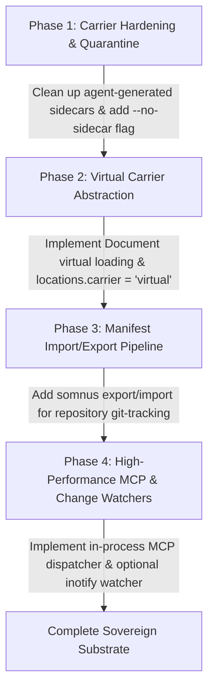

1. **Phase 1: Quarantine & Clean Up Forced Sidecars**
   - Provide a safe utility to purge agent-generated sidecars (`*.py.somnus.yaml`, `*.md.somnus.yaml`) across adopted roots.
2. **Phase 2: Introduce Virtual Carrier in Core Engine**
   - Add `virtual` carrier handling to `document.py` and `store.py`.
   - Update `somnus stamp` with `--carrier=virtual` (or `--virtual`).
3. **Phase 3: Repository Manifest Export / Import**
   - Implement `somnus export` to serialize virtual metadata into a single `.somnus-manifest.yaml` per registered root, ensuring git portability.
4. **Phase 4: Performance & Live Freshness Upgrades**
   - Implement an optional background change watcher service for active developer sessions.
   - Replace subprocess-per-call MCP dispatch with resident in-memory execution.

---

## 26. Unresolved Questions and Required Experiments

1. **Virtual Carrier Identity Persistence Across File Moves:**
   - *Question:* If an unmanaged file tracked via a virtual carrier is renamed or moved without an embedded ID, how should Somnus preserve its identity?
   - *Experiment:* Test path-independent heuristic reconciliation (combining file hash, size, and fuzzy name matching) vs. requiring explicit `somnus mv` commands.
2. **In-Process MCP Server Concurrency:**
   - *Question:* Can `somnus mcp` transition from ephemeral child processes to an in-process asyncio dispatch loop without risking SQLite thread contention or session crashes?
   - *Experiment:* Benchmark SQLite WAL concurrent read/write throughput under multi-threaded Python stdio JSON-RPC load.
3. **Bounded inotify Filesystem Watcher Resource Consumption:**
   - *Question:* What is the memory and descriptor overhead of a lightweight core filesystem watcher on repositories with >50,000 files?
   - *Experiment:* Prototype an isolated Linux `inotify` watcher thread with an event coalescing queue and evaluate resource consumption under heavy git branch switches.

---

## 27. Source Evidence and Traceability

| Citation / Finding | Source File & Location | Verification Evidence |
| :--- | :--- | :--- |
| **Normative Contract** | `SPEC.md:1–962` | Semantic validator: 0 errors, 0 warnings. |
| **Ratified Decisions D1–D19** | `DECISIONS.md:1–363` | Fully cross-referenced against SPEC §1–§23. |
| **Closed Schema Validator** | `src/somnus/model/validate.py:1–875` | Closed schema enforcement; unknown fields rejected (`E_SCHEMA`). |
| **Restricted YAML Parser** | `src/somnus/yamlsub.py:1–450` | Double quotes enforced; anchors/nulls rejected (`E_YAML`). |
| **Host Byte Preservation Guard** | `src/somnus/document.py:188–202` | `_verify_preserved()` enforces `E_HOST` on any host alteration. |
| **Global Registry DDL** | `src/somnus/db/schema.sql:1–207` | Schema version 2; append-only triggers on `events` table. |
| **FTS5 Search DDL** | `src/somnus/db/search.sql:1–44` | Porter stemmer over unicode61 tokens; 1M character cutoff. |
| **Subprocess MCP Server** | `src/somnus/mcp.py:219–235` | `run_cli()` executes `sys.executable -m somnus.cli`. |
| **Agent Sidecar Producer Script** | `~/.codex/sessions/.../rollout-*.jsonl:1144, 1520` | Script `sidecarProducer` forced `.somnus.yaml` creation on `.py` and `.md`. |
| **Event Ledger Sidecar Records** | `~/.somnus/somnus.db:events` rows 2286–2377 | Action: `stamp`; Detail: `"native-generated sidecar; original host bytes preserved"`. |
| **Plugin Native Packaging** | `somnus-metadata-plugin/scripts/build-native.mjs:1–39` | Strictly exports exactly 8 production runtime files. |
| **Core Test Suite** | `tests/test_*.py` | 537/537 tests pass cleanly. |
| **Plugin Test Suite** | `somnus-metadata-plugin/test/*.test.mjs` | 26/26 tests pass cleanly. |

---
*End of Architecture Audit Document.*
